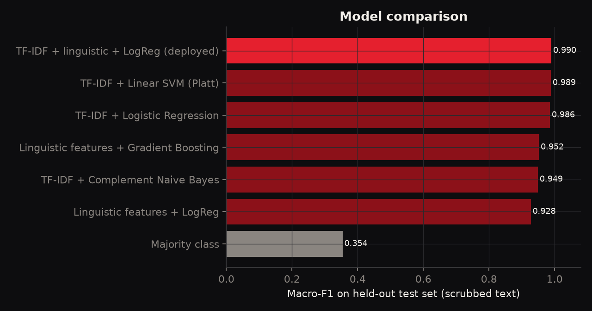
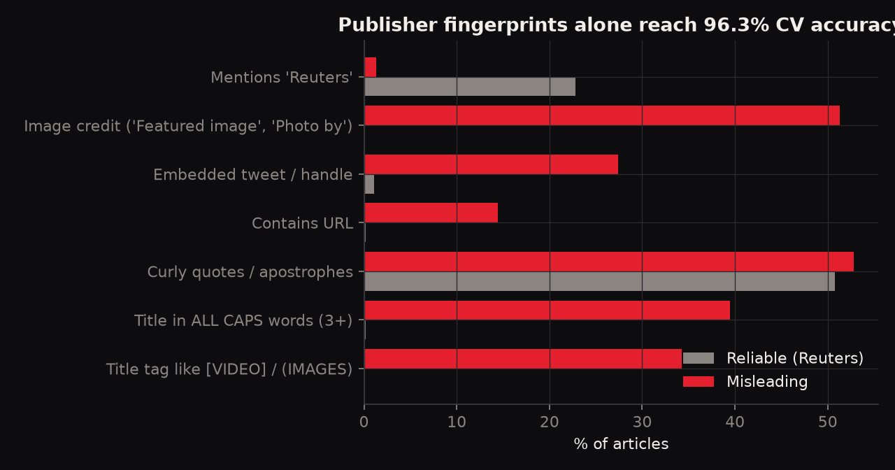
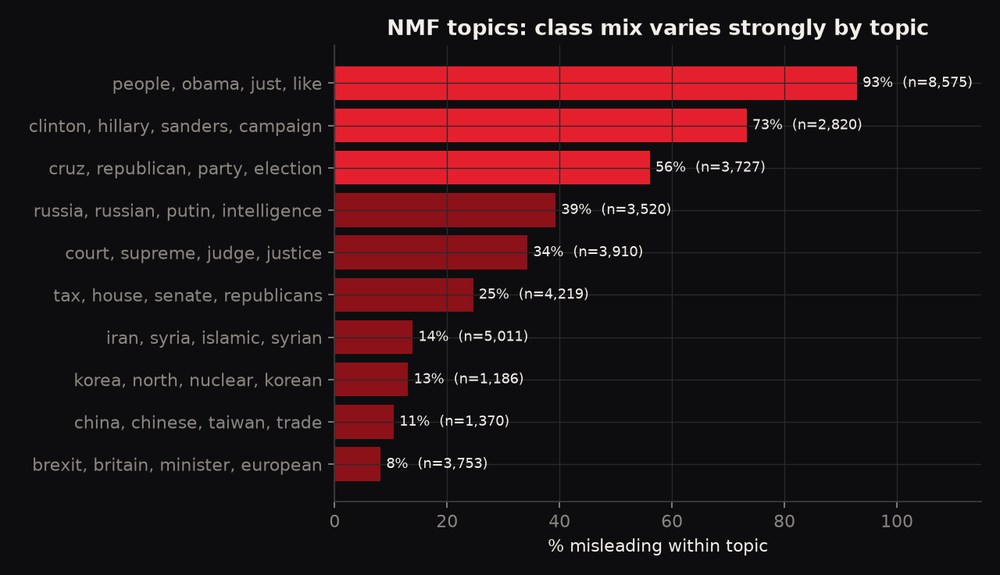
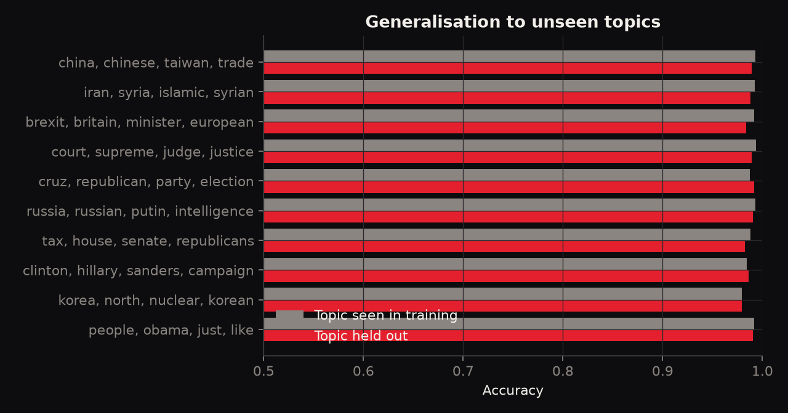
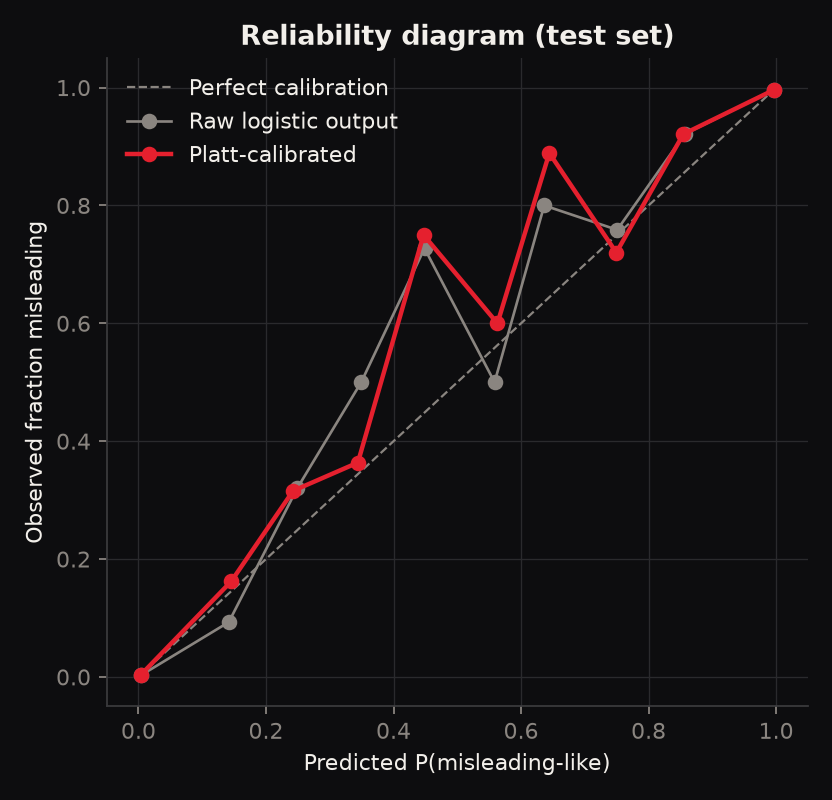

# Fake News & Misinformation Detector

> **Does this article *read like* the misleading news we've seen before?**
> A transparent NLP model that estimates how closely a news article's language resembles known reliable or misleading examples. It highlights the phrases that drove the estimate and reports a **calibrated** confidence.
> **It is not a fact-checker.** It never sees whether a claim is true.



**Live demo:** deploy it to Vercel in one click (see [Deploy](#deploy-to-vercel)). The website is fully static, and inference runs **in the browser**, so no text leaves the user's device.

---

## Highlights

| | |
|---|---|
| **ML** | 7 classifiers compared: majority baseline, linguistic LogReg, linguistic gradient boosting, TF-IDF Complement NB, TF-IDF LogReg, TF-IDF linear SVM, and the **TF-IDF + linguistic hybrid** that ships |
| **NLP** | TF-IDF word 1-2-grams (25k), 15 handcrafted linguistic/stylometric features, `all-MiniLM-L6-v2` transformer sentence embeddings |
| **Data science** | Publisher-artifact (source) leakage audit, NMF topic analysis, topic hold-out evaluation, class-imbalance study at 10% prevalence, Platt vs isotonic calibration, out-of-distribution test on WELFake |
| **Explainability** | Exact per-phrase contributions (weight x TF-IDF) highlighted inline, plus a per-feature breakdown of style signals |
| **Responsible framing** | Output is a *resemblance* score with a calibrated probability, uncertainty warnings, and a clear "not a fact-check" notice |

## Key results

Held-out ISOT test set (7,619 articles, publisher artifacts removed):

| Model | Accuracy | Macro-F1 | ROC-AUC | Brier | ECE |
|---|---:|---:|---:|---:|---:|
| **TF-IDF + linguistic + LogReg (deployed)** | 99.0% | 0.990 | 0.999 | 0.0072 | 0.27% |
| TF-IDF + Linear SVM (Platt) | 98.9% | 0.989 | 0.999 | 0.0090 | 0.28% |
| TF-IDF + Logistic Regression | 98.6% | 0.986 | 0.999 | 0.0114 | 0.78% |
| Linguistic features + Gradient Boosting | 95.3% | 0.952 | 0.990 | 0.0363 | 0.50% |
| TF-IDF + Complement Naive Bayes | 95.0% | 0.949 | 0.989 | 0.0392 | 1.81% |
| Linguistic features + LogReg | 92.8% | 0.928 | 0.977 | 0.0546 | 1.64% |
| Majority class | 54.9% | 0.354 | 0.500 | 0.2476 | 0.00% |

**Transformer embeddings vs TF-IDF** (all trained on the same 10k subsample):

| Model | Accuracy (ISOT) | Accuracy (WELFake, unseen) | ROC-AUC (WELFake) |
|---|---:|---:|---:|
| MiniLM embeddings + LogReg | 94.7% | 56.2% | 0.593 |
| TF-IDF + LogReg | 98.4% | 62.1% | 0.722 |
| MiniLM + linguistic + LogReg | 97.8% | 69.5% | 0.749 |

### The number that matters most

| Evaluation | Accuracy | ROC-AUC | ECE |
|---|---:|---:|---:|
| ISOT test (same sources as training) | 99.0% | 0.999 | 0.22% |
| WELFake (unseen sources, 4,000 articles) | **73.4%** | **0.795** | **18.3%** |

99% in-distribution accuracy is mostly a property of the dataset. ISOT's "true" class is Reuters wire copy and its "fake" class comes from a set of flagged websites, so the two are stylistically very different. On articles from other outlets the same model is right about three times in four, and it becomes **overconfident**: 73% of its WELFake predictions are still above 90% or below 10%. That is why the app talks about *resemblance* and never about truth.

## What's inside

### 1. Source analysis: publisher fingerprints
Before any modelling, `02_source_topic_analysis.py` measures how much of the label can be recovered from **publisher artifacts alone**, such as mentions of Reuters, "Featured image via...", embedded tweets, URLs, ALL-CAPS titles and "[VIDEO]" tags. A logistic regression on these 7 binary markers reaches **96.3% cross-validated accuracy**. All of them are scrubbed from the text (`src/fnd/text.py::scrub`) so the model has to rely on language. The dataset's `subject` column separates the classes perfectly and is excluded entirely.



Leakage check: the same TF-IDF + LogReg on *raw* text scores 99.3% accuracy versus 98.6% on scrubbed text. The raw model's top "reliable" terms include `reuters`, which shows how quickly a model latches onto the publisher.

### 2. Topic analysis
NMF (10 topics) on TF-IDF shows the class mix is far from uniform. For example, Brexit/EU coverage is almost all reliable, while the "people, obama, video" cluster is almost all misleading.



In the **topic hold-out** test, each topic is removed from training and the model is evaluated on it. Accuracy barely moves, so within ISOT the signal is mainly stylistic rather than topical.



### 3. Class imbalance
Real feeds contain far less misinformation than ISOT's ~45%. Train and test are resampled to 10% misleading, and three strategies are compared:

| Strategy | Precision | Recall | F1 | PR-AUC |
|---|---:|---:|---:|---:|
| Unweighted, threshold 0.5 | 0.971 | 0.920 | 0.945 | 0.990 |
| Class-weighted (balanced), threshold 0.5 | 0.939 | 0.961 | 0.950 | 0.991 |
| Unweighted, F1-tuned threshold (0.21) | 0.930 | 0.968 | 0.948 | 0.990 |

### 4. Calibration
A Platt sigmoid is fitted on a separate calibration split (10% of data). Test ECE goes from 0.27% (raw) to **0.22%** (isotonic: 0.34%). The website uses these reliability bins to explain each score, for example: "among held-out articles scored 70–80%, 72% were misleading" (the middle bins hold few articles, so the site shows each bin's sample size).



### 5. Explainability
The deployed model is linear, so each phrase's contribution to the logit is exactly `coef x tfidf_value`, and each style feature's contribution is `coef x z-score`. The browser computes these values exactly. Nothing is approximated with post-hoc attribution. Bigram contributions are split between their two words for inline highlighting.

## Repository layout

```
.
├── web/                     # static website (Vercel output directory)
│   ├── index.html
│   └── assets/
│       ├── css/styles.css   # red & black "newsroom noir" theme
│       ├── js/model.js      # JS port of the feature pipeline + model
│       ├── js/app.js        # UI, highlighting, charts
│       └── data/            # model.json (exported weights), report.json (all metrics)
├── src/fnd/                 # Python package: text scrubbing, features, metrics
├── scripts/                 # numbered, reproducible pipeline steps
├── reports/                 # JSON metrics + figures (generated)
├── tests/parity.mjs         # asserts JS inference == Python inference
├── docs/MODEL_CARD.md
├── run_pipeline.sh
└── vercel.json
```

## Reproduce

```bash
python -m venv .venv && source .venv/bin/activate
pip install torch --index-url https://download.pytorch.org/whl/cpu   # optional, for embeddings
pip install -r requirements.txt
./run_pipeline.sh          # ~25 min on a laptop CPU (embeddings are the slow part)
```

Every number on the website comes from `web/assets/data/report.json`, which `scripts/08_build_site_data.py` generates. `tests/parity.mjs` re-scores 25 held-out articles in Node and checks that the browser model matches Python to within 1e-3 (currently ~1e-5).

Run the site locally:

```bash
cd web && python -m http.server 8000   # open http://localhost:8000
```

## Deploy to Vercel

The project is already configured (`vercel.json`: no framework, no install, output directory `web`).

**Option A: dashboard.** Go to [vercel.com/new](https://vercel.com/new), import this repository and click **Deploy**. No settings need to change.

**Option B: CLI.**
```bash
npm i -g vercel
vercel          # preview
vercel --prod   # production
```

## Data

* **Training:** [ISOT Fake News Dataset](https://onlineacademiccommunity.uvic.ca/isot/2022/11/27/fake-news-detection-datasets/) (University of Victoria), loaded from the [Hugging Face mirror](https://huggingface.co/datasets/ErfanMoosaviMonazzah/fake-news-detection-dataset-English). 44,267 rows reduced to **38,091** after removing 6,176 duplicates and very short texts. Split 70 / 10 / 20 (train / calibration / test), stratified.
* **Out-of-distribution:** [WELFake](https://huggingface.co/datasets/davanstrien/WELFake), with any article whose text or title appears in ISOT removed. Note: in this mirror, `label = 1` marks *fake* articles, contrary to the dataset card. This was verified by inspection.

Raw data is downloaded by the scripts and is not committed.

## Limitations and responsible use

* **Labels describe sources, not claims.** "Misleading" means "published by a site that was flagged as unreliable", not "this sentence is false".
* **Narrow window.** The data is mostly US politics and world news from 2015–2018, in English only.
* **Overconfident out of distribution** (ECE 18.3% on WELFake). The UI warns when text is short or uses unfamiliar vocabulary.
* **Gameable.** A false story rewritten in wire-service style will score as reliable.
* Use the tool to prompt questions (who is quoted, where is the primary source), not to label people or outlets.

See [`docs/MODEL_CARD.md`](docs/MODEL_CARD.md) for the full model card.

## License

MIT, copyright Kunal Datta. Dataset licences belong to their respective authors.
